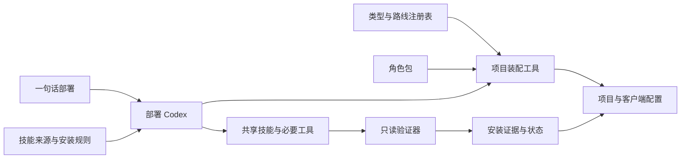

# AI-SMA v2 实施契约

用户已批准的范围：九种可装配视频项目、24 个角色、共享技能真实安装、三系统核心、原生子 agent 与单 agent 代行、四类真实小样。安装由部署智能体执行，不实现下载或包管理器自动安装程序。

## 共享接口

- `模板/项目类型.json`：`schema_version: 2`、`profiles`（按 id 的对象）、`routes`（按 id 的对象）。profile 包含 name、aliases、form、roles（角色 id 列表）、skills（额外技能名列表）、routes（默认路线 id 列表）、platforms、video、delivery、workflow。route 包含 name、roles、skills、runtimes。工作流是 phases 数组，每项含 id、name、owners（角色 id）、requires（前置阶段 id）；验收规则由模板明确。
- profile id：social-account、long-form、science、advertising、launch、film、series、music-video、motion-design。route id：ai、live-action、code-2d、cg-3d；hybrid 由两个以上 route 组合表达。
- `模板/角色.json`：`schema_version: 2`、`roles`（按角色 id 的对象），各项含 folder、name。角色内容在 `骨架/agents/role/<folder>/`；部署只复制选中角色。总负责人和后期中的既有工具继续可引用。
- `骨架/agents/公共/技能来源.json`：`schema_version: 2`、`sources` 和 `skills` 对象。source 含 repository、ref、package_root、license、status；skill 含 source、entry、category、requires、runtimes、clients、verification、status。status 为 ready / candidate / blocked；必需集合不允许不明来源伪装为 ready。可增加说明字段。
- 新项目 `agents/项目/项目配置.yaml` 使用 JSON 文本（合法 YAML，Python 标准库可读），schema_version=2；包含 project（name/profile/form/stage/language/timezone/client）、content（production_routes）、platforms、video、delivery、autonomy、team（roles/execution_mode）、skills（required）。旧账号配置仍可读取。
- 安装回执 `agents/项目/安装回执.json`：schema_version=2，skills 为按技能名的对象，记录 source/ref/path/digest/verification/client 状态；tools 按工具名记录。空回执代表未验证，不能自行填成功。环境检查提供结构化结果且退出码真实；不执行安装。
- 任务 v2 保留原 task.json 目录结构，增加 parent_id、depends_on、unit、input_versions、review_mode；兼容读取 v1。上游改动使依赖待复核。跨平台锁由任务工具负责。
- 每个角色配置保留 skills（全部所分配技能）并增加 preload_skills（启动加载子集）；未装好技能不能被静默过滤后宣称就绪。

## 架构

各角色通过版本化产物交接；仅独立工作包并行；共享清单单写者。默认并发 3、返工 2，不覆盖用户模型设置。无子 agent 时顺序代行，审片标为 self。角色只加载当前任务需要的技能，避免把全部技能注入上下文。

## 顺序与验收

1. 来源及模板角色矩阵 → 2. 通用配置和状态 → 3. 装配/验证/恢复 → 4. 文档及客户端 → 5. 九模板部署、异常与四小样验证。
记录实际验证的 OS、客户端和制作路线；未运行的不写已通过。既有项目不迁移。新建账号.py 保留 CLI 兼容。自研技能在 my-skills 开发并发布后同步安装副本；公共模板不含作者路径、账号或凭据。
