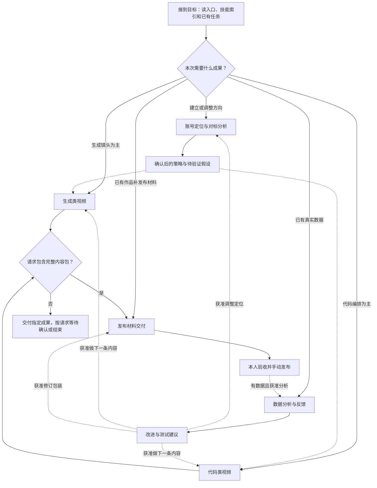

# SOP · 导航与共同约定

SOP 规定怎么做。红线和任务路由在根目录 `AGENTS.md`，细则在 `../规范/项目规则.md`，业务标准在 `../规范/内容与交付.md`，技能入口在 `../SKILLS_INDEX.md`，任务状态命令在 `../tools/任务管理/README.md`。

## 1. 选 SOP

| 目标 | SOP | 任务类型 | 终点 |
|---|---|---|---|
| 刚部署的新项目：说明用法、准备事项和必答问题 | [新账号开工](新账号开工.md) | 不登记 | 回答写进规范，入口的开工提示删掉 |
| 建立或调整定位，研究对标 | [账号定位与对标分析](账号定位与对标分析.md) | research | 有依据的共同方案、本人确认和验证计划 |
| AI 生成镜头为主的视频 | [生成类视频](生成类视频.md) | content | 请求范围内的源素材、成片或完整内容包 |
| 代码、真实界面和动效为主的视频 | [代码类视频](代码类视频.md) | content | 请求范围内的预览、成片或完整内容包 |
| 给实际作品做封面、标题、正文、标签和内容包 | [发布材料交付](发布材料交付.md) | 独立任务用 delivery；视频任务内沿用 content | 指定的文字或封面，或完整内容包 |
| 分析已发布内容并反馈 | [数据分析与反馈](数据分析与反馈.md) | research | 真实数据、结论边界和可检验的改进 |
| 项目维护 | 本文第 6 节 | maintenance | 变更完成并通过检查 |

图文等还没单列的任务用内容流程和对应技能，不硬套视频 SOP。混合视频选一条主制作路径，再借用另一份 SOP 的必要步骤，不重复登记同一项工作。

## 2. 总流程

虚线表示条件成立后才启动，不代表自动授权。定位确定后可以直接作为输入，每条视频不用重新做定位。

## 3. 开始每个 SOP

1. **定范围。** 用 social-media-router 明确本人要求、已有材料、终点和不确定项；只问会实质改变方案的缺项。讨论、总结、审查停在对应范围，不默认变成制作。
2. **查重与接续。** 查任务总览和对应 task.json，内容任务加查选题池和必要的账号数据；已有任务就接续，没有再用任务工具创建。
3. **登记路径。** 把 SOP 路径加入任务 inputs，写明目标和可检查的完成条件；每次交接在 next_action 写步骤编号、当前文件和恢复条件。
4. **读技能。** 先完整读该步骤列出的技能，再读点名的参考；工具先核实能力、依赖和版本，不直接运行含占位路径的示例。
5. **按步骤放行。** 前提或关键检查不满足，就暂停依赖它的动作；保存实际产物和证据。

## 4. 共同约定（各 SOP 不再重复）

- **终点。** 只做到本人要的成果：提示词、原片、预览、成片、完整内容包是不同终点；不顺手补封面文案、加场景或多做一轮。
- **确认。** 选题和方案用任务的 topic、plan 确认登记，绑定具体文件版本；核心方案变了，受影响的确认重新取得；本人没回复就等待。
- **外部任务。** taskId 和回包当场落盘，结果不明先查原任务，不盲目重提。付费、上传、重新生成、登录不因技能串联而自动获得授权。
- **检查。** 每项写对象、方法、结果、证据和未验证范围；文件检查、抽帧、连续播放、试听分开报告。没做的写"未验证"，失败不写成通过，静帧不能证明运动和声音。
- **文件。** 工程、草稿、回包、素材副本、参考和检查留在当前任务目录；完整包在交付暂存整理检查后，复制到 `交付/` 的全新目录。
- **结束。** 达到完成条件就更新任务、必要知识和日志，简洁交付后停止。缺确认、证据或有实质缺项时，保存已有结果并如实等待，不为满足机器结束条件伪造交付。
- **反馈。** 报告里的建议不自动变成新的生产任务、持续监测或采集；方向结论经本人确认后才写回规范。

## 5. 交接记录

每次交接只记必要信息，可以并入现有简报、报告或任务记录，不为此建空文件。

| 项目 | 写什么 |
|---|---|
| 目标与范围 | 任务 ID、选定 SOP、请求终点、已授权的操作 |
| 决定与确认 | 锁定的决定、本人来源、确认的文件和版本；没确认就写待确认 |
| 实际产物 | 当前有效文件，原片、工程、成品的关系，相对项目根目录的路径 |
| 技能与工具 | 实际用的技能和必要子项、工具与版本、关键方法 |
| 证据与限制 | 检查方法、结果、证据位置；来源和许可条件；未验证范围 |
| 下一步 | SOP 步骤编号、要处理的事、在等谁或什么条件 |

## 6. 任务类型与机器阶段

阶段和必经确认的机器定义在 `../tools/任务管理/流程定义.json`；SOP 步骤编号写在 next_action，不当作 phase。

| 任务类型 | 机器阶段（括号内为对应 SOP 步骤） | 必经确认 | 本人验收 |
|---|---|---|---|
| content | 选题（G／C01–03）→ 脚本（04–05）→ 制作（06–10）→ 检查（11）→ 交付（12；完整包接 D01–D09） | topic 在脚本前，plan 在制作前 | 需要 |
| delivery | 理解作品（D01–02）→ 包装方案（D03–04）→ 制作材料（D05–06）→ 检查（D07）→ 交付（D08–09） | 没有新的选题、脚本确认 | 需要 |
| research | 问题 → 取证 → 分析 → 沉淀（定位按 P01–P10，数据按 A01–A08） | 要改既定定位时加 positioning 确认，放在沉淀前 | 不需要 |
| maintenance | 查现状 → 方案 → 执行 → 检查 → 沉淀 | 涉及权限、自动执行范围、删除时按授权确认 | 不需要 |

**内容任务**：本人直接指定的选题可按原话登记确认；本人只要一个提示词等窄成果时按明确范围交付。验收不通过就在原任务内修订，新增交付重新等待验收。发布数据到齐后另建复盘任务，不把制作任务挂在等发布上。迁移来的旧任务不追认历史确认，未确认的文案、声音许可和检查限制写进 issues。

**独立发布材料**：没有新的视频脚本确认，但不等于可以改源片；只要文字或封面时按实际范围交付，不能称为三文件完整包。

**研究**：问题明确且已授权时直接取证，不为每一步新增确认。证据不足时交已证实部分和缺口，缺口影响完成条件就保持等待。简单问答直接回答，不建研究目录。

**项目维护**：
1. 查现状：读最小必要的文件和引用，确认已有工作和目录权限，写清影响范围和完成条件。
2. 方案：列出要改的文件、理由和验证方法；涉及权限、自动执行范围、删除时按已有授权判断是否要确认。
3. 执行：在范围内修改，写前重读；不改无关工程、受保护目录或共享技能源。
4. 检查：运行 `../tools/项目检查/检查.py`；程序改动另测真实行为，失败先诊断，不重复无效检查。
5. 沉淀：更新对应规范、入口、索引和当天日志，登记结束和剩余限制。

项目升级先在本项目验证，再考虑通用提炼；不顺手安装技能、调度器、后台服务或创建其他项目。维护任务内部检查通过就可以结束，但不代表本人验收了主观体验；本人要求先验收时，登记确认条件并等待。

## 7. 异常处理

| 情况 | 现在做什么 | 什么时候恢复 |
|---|---|---|
| 缺目标、关键材料或必要授权 | 记录缺项并问本人，先做不依赖它的工作 | 收到必要信息或明确授权 |
| 确认后的核心方案变了 | 受影响的确认改为待定，回到对应方案步骤 | 新方案确认；没变的部分不重复确认 |
| 外部提交结果不明 | 保存请求、回包和 ID，停止重提 | 查清原任务状态，按工具规则恢复 |
| 产物不合格 | 记录时间码和具体缺陷，选成本合理的修法 | 受影响部分重查通过 |
| 缺播放、试听或数据能力 | 保留能证实的部分，标未验证 | 有了检查能力，或本人明确接受这个限制 |
| 版本或目录冲突 | 重新读取记录，选新的交付名称，不覆盖 | 当前版本和目标目录核对通过 |
| 请求已完成 | 更新任务和必要记录，简洁交付后停止 | 本人提出新的明确请求 |
