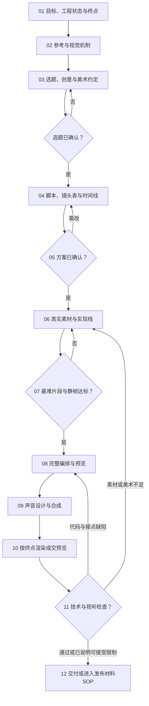

# SOP · 代码类视频

代码视觉短片、艺术动效、真实网站或产品演示，以及用代码编排的讲解视频：参考、选题、创意与脚本、视觉和运动设计、素材、实现、预览、声音、渲染和检查。代码是制作手段，不能用几何和文字替代作品需要的真实图像和素材。任务类型 content，确认 topic、plan；共同约定见 [README](README.md) 第 4 节。只要审查、修改或预览时停在那个范围。

技能入口见 `../SKILLS_INDEX.md`。选一个主要实现栈，其他工具只补具体缺口；项目规范里的产品片默认栈和声音要求优先于技能的通用默认，技能的镜头、QA 和依赖规则要实际执行，不能只写"用了某风格"。

## 步骤

### C01 终点与已有工程 · social-media-router、direct-video；已有工程加读对应 Remotion 或 HyperFrames 路由
- 确认是新作品、改已有作品、只要预览，还是导出完整视频或内容包，登记可改的范围。
- 看现有简报、时间线、资产和版本；保留本人或其他 agent 已改的内容，不用旧快照整体覆盖。
- 锁定受众、观看反应、画幅和时长目标、声音和输出形式；关键未知项先问，其余按规范和专业判断定。
放行：请求终点明确；具体修改不需要重开完整的创意访谈。

### C02 参考与视觉机制 · content-planning、direct-video；艺术和动画机制先看 huashu-art-motion
- 新方向找少量专业参考和原作者来源，回答构图、材料、运动、信息或镜头怎样服务主题；已有方向只查影响本次改动的疑点。
- 找适用的技能、真实 Demo、示例源码和素材，记录来源、许可、版本和依赖；按用途改编，不把示范的题材和构图直接搬成作品。
- 动画参考要实际观看并标关键时间点，放不了就只评价看得到的静帧。热度用于发现参考，不代替审美判断。
放行：说得清为什么适合本片；现有方法达不到视觉目标就换实现路线，不靠更多特效掩盖。

### C03 选题、创意和美术约定 · content-planning、direct-video、huashu-art-motion
- 写清观众在等什么、画面产生什么变化、结尾兑现什么；形式和情绪作品也要有发展和完成感，不强制写成剧情。
- 确定构图、色板分工、字级、材质与光线、运动性格、转场逻辑和声音关系，写成简洁的美术约定。
- 新风格或新角色方向按所选技能的比较和确认方法做；已锁定的方向不强迫每次小改都重出多个方案。
- 交本人确认选题；huashu 条款和项目身份、制作要求冲突时以项目为准，记下适配理由。
产出：选题、概念、美术约定，登记 topic。放行：有具体的视觉事件和质量参照，不能只有"高级、科技感"这类形容词。

### C04 镜头表与时间结构 · content-planning、direct-video；用 huashu 时按它的镜头表要求写
- 每个镜头写时间范围、目的、主体、实际变化、镜头、文字和阅读时间、声音、衔接和实现方式。
- 全片和局部动画的时间对得上，算上素材载入、信息停留、转场重叠和尾音；数据、界面和文案要有真实依据。
- 标出最难实现、最影响第一眼和关键回报的区间。
- 用 huashu 引擎或语法时执行它的镜头表检查，红灯先解决；项目规格覆盖横屏、旁白等通用默认。
产出：脚本或镜头表、素材需求、制作风险。

### C05 确认方案版本 · social-media-router；任务工具登记确认
- 提交脚本、核心构图、美术、技术路线和实质待决项，必要时附可审阅的样帧。
- 用 plan 确认绑定当前文件版本和本人来源，再进入实现。
- 核心机制改变就回 C03 或 C04 重新确认；普通排版、修 bug 等既有范围内的修复自主推进。

### C06 真实素材与实现栈 · asset-generation；Remotion 或 HyperFrames 路由与子技能；产品片加 video-shotcraft
- 查附录和已有文件，实际查看截图、图像、模型和字体。产品片用真实页面和真实结果，不重画虚构界面冒充产品。
- 缺素材按素材技能补齐并验收；需要生成镜头时借用[生成类视频](生成类视频.md)的素材和执行步骤。
- 产品片默认 Remotion；HTML／GSAP 画面按目标选 HyperFrames；huashu 提供艺术配方和机制。没有理由不迁移现有工程，也不每个片段换一套框架。
- 创建、实现、预览、渲染分别读对应子技能：HyperFrames 写合成前读 hyperframes-core，命名效果先查 hyperframes-registry；Remotion 新合成读 remotion-create，画面实现读 remotion-markup，预览和渲染读 remotion-studio、remotion-render。
- 记录实际工程路径、素材来源、依赖和版本；不改共享技能源。
放行：关键素材真实存在、能加载、许可可靠；插件名称不能证明工具已连接或能渲染。

### C07 先做关键静帧和最难片段 · direct-video；实现栈的预览和渲染方法；huashu 的适用 QA
- 先完成代表性的主画面和结尾构图，再做最难的几秒运动，不直接花时间渲染整片。
- 在交付分辨率和手机尺寸下和专业参考并排对照，检查材料、光、文字、比例、身份和焦点，指出看得见的差距。
- 验证字体、图片、模型加载后的真实导出，不只看开发页面；离线帧和预览一致，跳到任意时间都能得到正确画面。
放行：关键画面和动作达标再做整片；机制普通或素材不足回 C06，不靠加粒子或调 easing 混过去。

### C08 完整画面与时间线 · Remotion markup／studio，或 HyperFrames core／animation／keyframes；content-production
- 按镜头表实现内容、文字、安全区和运动，用统一的设计参数；随机量固定种子，画面状态只依赖时间或帧，不依赖交互时序或系统时钟。
- 资产和字体加载完成再导出；异步资产的准备与重绘、路径、裁切和透明背景按框架方法核对。
- 转场、运镜和切点服务具体变化，留够阅读和回报时间；不会动的素材不靠整帧呼吸或匀速慢推凑时长。
- 在实际预览里复看关键区间；本地预览遵守项目浏览器规则，不把没加载出来的页面当成功。
放行：内容完整，能准确定位每一段；技术故障先找根因，不反复无效重渲。

### C09 声音与文字表现 · content-production、media-use；用 HyperFrames 混音时读 hyperframes-audio
- 声音按已确认方案和 `内容与交付.md` 第 2 节，记录音乐和拟音的来源与许可，对准实际动作和节拍，处理接点、层级和尾音。
- 角色和台词的表现方式按 `内容与交付.md` 第 2 节，文字的阅读时间和动作对齐；模板的默认旁白不能覆盖项目要求。
- 确认导出的音轨映射和原音轨的使用范围；试听和响度、峰值检测分开做、分开记。
放行：内容和许可都符合要求；缺可用音乐或服务额度按工具规则处理，不换成被禁用的方案。

### C10 按终点预览或导出 · Remotion studio／render，或 hyperframes-cli；content-production
- 只要方案或预览就交那个成果，标明还没导出，不自动开始额外渲染或包装。
- 要完整视频、MP4 或内容包时，按所选框架的渲染技能，用当前工程的真实命令和输出路径。
- 记录成片路径、真实时长、帧率、尺寸、编码和音轨；技能内部的 QA 和报告留工作区，不放进社交内容包。
- 导出失败先判断是资产、字体、时间线、依赖还是运行环境；进程跑完或预览能播都不等于导出完成。

### C11 检查导出结果 · direct-video、content-production、video-frames；所选艺术引擎的 QA
- 检查完整解码、实际规格、加载、字体和合成是否正确，以最终导出为准。
- 实际看主画面、手机尺寸、快速动作和切点，记录完整播放的范围；能试听就试听。
- 用 huashu 引擎时执行它的镜头表、逐镜 QA、成片门禁和独立审片要求，红灯不能作为合格成片交付。
- 缺陷按时间码和影响回到素材、实现或混音步骤，改完重查受影响区间和最终组装；不拿静帧比例、效果数量或自评分当质量结论。
产出：检查和修复证据，任务 checks 引用当前报告。

### C12 交付与反馈 · social-media-router；完整包进入[发布材料交付](发布材料交付.md)
- 交实际成果；源工程按请求提供，工程、参数和检查不替代主成片。
- 完整包把成片、受众、看点、来源和检查限制交给发布材料 SOP；只要成片就按窄成果整理。
- 登记真实交付版本和本人验收；只做到预览就停在预览，不伪造 MP4 或包记录。
- 实际发布后的数据分析要有授权和真实数据；改进回到本片的具体步骤或下一次方案，经验留在项目，不自动改共享技能。

完成条件：目标兑现，实际成果可用，方案已确认，来源完整，检查范围真实，版本和终点明确。能运行的工程和静态截图不能单独证明视频已完成。
