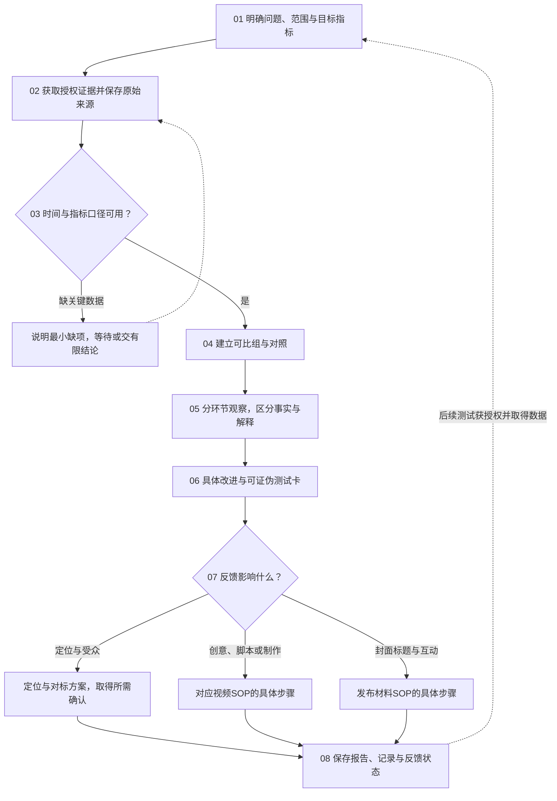

# SOP · 数据分析与反馈

分析本账号已发布内容的表现、复盘实验，并把反馈交到下一步。回答曝光、点击、观看、互动、关注或转化的具体问题，输出可检验的改进；不能只列数字，也不能凭单条帖子判断创意因果或全账号限流。任务类型 research；共同约定见 [README](README.md) 第 4 节。只有公开对标数据时走[账号定位与对标分析](账号定位与对标分析.md)；没有数据时可以整理采集需求和测试设计，不编造复盘结果。

反馈先交具体建议；没有执行授权时不自动改作品、定位或生产新内容，也不自动开启持续采集。技能：social-media-router、performance-analysis（data-contract、comparison-and-tests）、content-planning，解释包装和作品时配合 publishing-delivery、content-production；入口见 `../SKILLS_INDEX.md`。

## 步骤

### A01 问题、范围和成功信号 · social-media-router、performance-analysis
- 明确这次解释哪个环节或检验哪张测试卡；区分"本周新增的表现"和"本周发布内容的累计表现"。
- 确定平台、账号、内容范围、日期或发布后窗口、目标指标和请求终点，只选和目标相关的字段。
- 读作品和账号数据记录、有效作品和包装版本；资料缺失标未知，不因交付目录存在就推断已经发布。
放行：问题能用拿得到的数据回答；没有后台授权时用本人提供的数据，不自行扩大账号范围。

### A02 收集并保留原始证据 · performance-analysis（data-contract）
- 优先用本人提供的导出、截图或已授权的只读查看；需要本机网页时遵守浏览器和登录规则，不改筛选以外的账号设置、帖子或权限。
- 保存原始来源、页面和筛选条件、截图或提取时间、平台时区、可见范围和必要的发布证据；转录和计算另存，不覆盖原文件。
- 只收需要的聚合指标和内容信息，检查分页遗漏、重复 ID、模糊字段；缺值、隐藏、延迟和零分开记。
- 不浏览本人的点赞和收藏列表；后台点赞数、收藏数作为指标可以用，不收无关观众的身份或联系方式。
放行：数据可追溯；登录失效就停止依赖它的动作，截图看不清不猜数。

### A03 校准时间、单位、分母和版本 · performance-analysis（data-contract）
- 每个指标记平台原名、定义、单位、来源、口径（累计、区间、滚动或快照），比率记分子和分母；定义不明就写"未核实"。
- 分清发布时间、报表日期、提取时刻和发布后时长；只有日期时不编造精确小时数，时区差异要统一或注明。
- 同口径的两次累计快照才能算区间增量；滚动窗口的差值不当新增，出现负值先核对，不静默归零。
- 分母缺失或为零就不算比率；互动动作相加不是去重人数，平均观看占比不冒充完播率。
- 核对封面和标题版本、片长、置顶、投放、审核、修改或重发等状态，保留会影响结论的标记。
放行：指标能回答问题；缺关键分母或时间时只给有限观察，不把模板空项补成事实。

### A04 建立可比组 · performance-analysis（comparison-and-tests）
- 优先同平台、同口径、发布后时长相近或观察窗口相同的比较；不同阶段的累计播放只能描述截至某时的规模。
- 分层或标注片长、题材、形式、投放、置顶、时段、账号阶段和审核差异，保留总体概览和过滤理由。
- 计算过程和过滤可复现；简单表手工核对，复杂数据选合适的计算工具，不只凭截图排序。
放行：对照条件和口径足够明确；对不齐就报告限制，不用"播放 ÷ 上线天数"冒充同等机会下的质量比较。

### A05 分环节解释表现 · performance-analysis；作品观察配合 content-production、publishing-delivery

| 环节 | 有数据时看什么 | 可以检查的内容因素 |
|---|---|---|
| 被看见 | 曝光或触达、流量来源、可见的审核状态 | 题材、受众、分发入口和执行状态 |
| 被点击 | 平台定义的点击指标和分母 | 封面识别、标题关系、观看承诺 |
| 持续观看 | 留存、平均观看、完播率和片长 | 开头、信息发展、节奏、切点、结尾兑现 |
| 互动与关注 | 收藏、分享、评论、关注，注明计数和分母 | 有用性、共鸣、具体互动问题、持续关注的理由 |
| 使用或商业目标 | 可追溯的使用、注册、咨询、付费 | 需求匹配、承接过程和产品价值；没有数据不推断 |

- 每个发现按"事实和窗口／可能解释／竞争解释／未知"写，给出关键计数和样本范围。
- 对照真实作品指出看得见的问题；作品观察和专业判断单独标注，技术完成不等于观众喜欢。
- 单条低曝光、推荐占比、审核标签都不能证明算法原因或全账号状态；规则和新证据冲突时登记待决，不自行改账号或重要规则。
放行：不把相关当因果，不宣称小样本有统计证明；没有某个环节的指标就不判断那里发生了什么。

### A06 具体改进和测试卡 · performance-analysis（comparison-and-tests）；创意反馈配合 content-planning
- 选成本合理、信息收益高的一个或少量改动，具体到下一次的脚本、画面、标题封面或互动问题。
- 每张测试卡写问题、假设、改什么、尽量保持什么、主指标和分母、必要的质量保护指标、对照、观察窗口和提取时间。
- 写清什么结果支持、削弱或无法判断假设，以及对应的下一步；没有样本量依据就写"探索性比较"。
- 多项同时改只能评估整组变化；同账号顺序发布通常不是随机实验，注明时间和受众波动的限制。
放行：下一次能观察到是否有效，不只写"优化标题""提升质量"。

### A07 把反馈交到具体步骤 · social-media-router、content-planning；包装用 publishing-delivery，制作用 content-production
- 受众、价值、变现假设的反馈，交[账号定位与对标分析](账号定位与对标分析.md)的 P03、P07、P08，并提交所需的定位变更确认。
- 观看动力、脚本、源素材或节奏的反馈，交对应视频 SOP 的具体步骤，写清依据、要改的文件和当前授权。
- 点击和互动的反馈，交[发布材料交付](发布材料交付.md)的 D03、D04、D06，关联原组合版本和测试卡。
- 反馈写明原任务或作品 ID、问题、证据、目标步骤、拟改动和验证方式；记录"建议、已确认、已执行、待观察、已验证"的实际状态和来源，提出建议不等于已经改进。
放行：接手的人知道改什么、怎么判断；没有执行授权只交建议。

### A08 报告、沉淀与停止 · performance-analysis、social-media-router
- 先给可靠发现和实用建议，再列来源、时间、口径、样本、重要限制和测试计划；原始数据和计算可追溯。
- 原始证据、快照和正式报告进 `../账号数据/`；方向性结论经确认后回定位与策略；外部知识进 `../规范/外部知识.md`；过程和计算留任务目录。
- 检查缺失、单位、百分比和百分点、增量、过滤和版本；登记报告、检查证据、任务和当天日志。
- 当前报告完成就停；后续跟踪只在明确授权的范围和观察窗口内进行。

完成条件：回答了请求的问题，数据和限制真实，改进具体可检验，并已交到对应步骤。证据不足影响完成条件时保持等待或受阻，交已证实部分和最小补充项。
