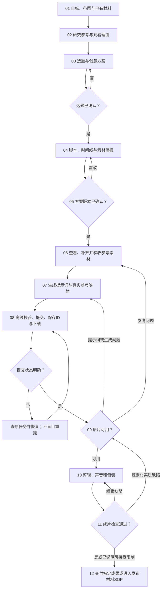

# SOP · 生成类视频

以 AI 生成镜头为主要画面的视频：选题策划、参考、创意、脚本、素材、生成、剪辑和成片检查。生成回包不是作品；主要靠代码组织画面的走[代码类视频](代码类视频.md)。任务类型 content，确认 topic、plan；共同约定见 [README](README.md) 第 4 节。规格和声音以任务和现行规范为准，不从生成工具的默认值反推创意。

技能入口见 `../SKILLS_INDEX.md`。需要艺术动效时先按[代码类视频](代码类视频.md)的选型评估 huashu-art-motion，不为包装默认增加新场景或付费生成。

## 步骤

### G01 目标、范围与已有材料 · social-media-router、direct-video
- 明确给谁看、希望观众有什么反应，这次只要提示词、原片、成片还是完整内容包。
- 核实实际文件和可用范围；锁定画幅、时长目标、声音、输出和许可，缺的用 `账号配置.yaml` 的默认值补。
- 登记输入、完成条件和已有授权；本人直接指定的选题按原话登记。
放行：核心目标明确；缺素材、上传许可或会改变方案的信息，先问并暂停依赖动作。

### G02 参考与观看理由 · content-planning（research-and-selection）、direct-video
- 判断来源是情绪表达、明确方向还是热点；热点按策略核验时效和低粉高互动证据，旧梗还有爆款不等于正在爆发。
- 新方向研究少量相关的原作者和专业参考；已有方案只查会改变决定的疑点。记录真实链接、日期和实际看过的范围。
- 拆出构图、画面事件、注意力、节奏、声音和结尾回报，说明本项目怎样形成不同的表达。
产出：参考证据卡和可迁移机制。放行：参考能解决具体创作问题；视频放不了就只写看得到的部分。

### G03 选题与创意 · content-planning、direct-video
- 提出具体的画面关系、过程、情绪或变化，不先让主体随机活动、再补一句隐喻。
- 必要时比较少量实质不同的方案，看观看理由、结尾兑现、审美辨识度和生成可行性，收敛到一个。
- 明确角色用途、场景和全片美术，对照策略和规范；检查撞题，同一身份不等于创意重复。
- 交本人确认选题；本人已指定就登记出处。
产出：选题、概念、美术约定，登记 topic。放行：核心画面机制弱就改概念，不靠更长的文案掩盖。

### G04 脚本与三条时间线 · content-planning（story-and-brief）、direct-video
- 写全片时间结构：每段的目的、主体、动作或变化、构图、文字阅读时间、声音、前后状态和接点。
- 分清成片时间、生成段和镜头：先设计完整观看体验，再按模型能力拆请求，算上剪掉的无效区间、转场重叠和尾音。一段可以有多个镜头。
- 列素材：已有、缺失、可替代、非必需，写清参考用途、许可、跨段一致性和真正的串行依赖。
- 生成参考按现行多视图和场景规则使用，不擅自改成首尾帧或逐帧锁定。
产出：脚本、生成段清单、素材需求。放行：每段都说得清观众看到的新变化和回报；模型明显做不到的动作先简化或改方案。

### G05 确认方案版本 · social-media-router；可先用 ai-video-prompt 审查实现矛盾
- 给本人看脚本、核心画面、美术和规格，说明需要判断的关键选择和真实限制。
- 用 plan 确认登记具体文件版本和本人原话，再进入制作；确认方案不代表额外的账号操作或无限新增生成。
- 返修改变已确认的核心内容就回 G04，更新受影响的确认。

### G06 补齐素材 · asset-generation；补图用 imagegen 或 codex-imagegen
- 先实际看角色、场景和其他输入图，确认身份和构图能支撑关键动作，许可没问题。
- 角色和主体参考按 `账号配置.yaml` 的 identity 使用，素材表里分清每张参考的用途。
- 只补缺的素材：生图前读对应技能，传真实参考图，生成后实际检查身份、空间、美术和动作条件。图不过关先修图，不急着花钱生成视频。
产出：可用素材和"文件 → 参考用途"映射。放行：关键参考真实存在且支持方案；能力或素材权利不足时交离线计划和缺口。

### G07 提示词与真实参考 · ai-video-prompt、asset-generation、RH-minimax-H3
- 按当前视频提示词模板写完整提示词：每个生成段的时间从 0 连续推进，写清参考用途、变化、镜头、衔接和声音，项目的声音要求（见 `内容与交付.md` 第 2 节）明确写入。
- 对照 H3 当前的真实节点和上传槽位，用技能的构造器生成 jobs；参考文件名要对应真实上传。
- 交给本人的提示词按规范只给内容本身的 txt；jobs、上传映射和说明留在工作区。
产出：各段提示词、jobs、文件到节点的映射。放行：时间、引用、参数和已确认方案一致。

### G08 校验、提交、恢复与下载 · RH-minimax-H3
- 按 `../tools/runninghub-minimax-h3/AGENTS.md` 检查凭据配置、`--dry-run` 校验、提交、登记 taskId、恢复和下载。
- 依赖前一段真实结果的段落串行执行；不启动多个批次绕过并发额度。
产出：原片、回包、真实状态和用量。放行：有能解析的实际视频才进 G09；只有图片、ZIP 或状态不明时如实标记，按工具规则恢复。

### G09 审原片并决定返修 · asset-generation、content-production；video-frames 定位区间
- 探测真实容器、视频流、时长和尺寸；保留原始版本，放大不冒充原生分辨率。
- 能播放就完整看，按时间码记录身份和物件数量、动作是否兑现、光线空间、接续状态、文字和声音缺陷。
- 判断缺陷来自参考素材、提示词、模型结果，还是剪辑能解决的小问题，回到对应步骤修根因。
- 标出可用区间的入点、出点和用途；需要重新生成按当前任务和授权执行，不自动扩批次。
放行：核心内容成立；文件成功但内容失败不进成片。

### G10 剪辑与包装 · content-production、direct-video；音源 media-use；台词气泡用项目工具（如有）
- 按实际动作、信息和回报组织片子：去掉无效等待和重复，调整与原计划不符的区间，不按生成段边界机械拼接。
- 核对身份、运动方向、空间轴线和道具状态；转场服务接续关系，保留必要的反应和结尾停留。
- 声音按 `内容与交付.md` 第 2 节处理，记录来源和许可，核对音轨和动作对齐；需要台词气泡时按实际动作的时刻写时间表，不比动作早。
- 用后期工具前确认它的裁切、缩放和声音处理符合这次的范围；已定稿的片子只包装时不改源片。
产出：主成片、剪辑决定、文字或气泡时间表、声音来源和流映射。放行：观看承诺真的兑现；素材不够回 G09，不靠字幕声称没发生的结果。

### G11 成片检查 · content-production、direct-video、video-frames
- 检查导出文件的规格、时长、编码、字体、音视频流和完整解码，以实际文件为准，不看渲染命令的返回。
- 实际看开头、关键动作、每个接点、结尾和手机尺寸；快速动作要密集抽帧或连续播放。
- 有能力就完整播放和试听；声音来源许可、音轨计量和实际试听分别记录。
- 问题按时间码和影响列出，修完重查受影响区间和最终组装。
产出：检查证据，任务 checks 关联当前版本。放行：关键问题已解决；还有实质限制时只交明确待复核的版本。

### G12 交付与下一阶段 · social-media-router；完整包进入[发布材料交付](发布材料交付.md)
- 只要提示词或原素材就停在那里；只要成片就交完整文件和检查范围。
- 需要完整包时，把成片、简报、受众、看点、来源和检查限制交给发布材料 SOP，沿用同一任务。
- 成果新增到全新交付目录并登记当前版本；只交成片的窄交付可按确认范围登记 other。
- 等本人验收；真实数据到齐且获准分析后转[数据分析与反馈](数据分析与反馈.md)。

完成条件：达到请求终点，实际文件可用，来源和检查可追溯，核心方案已确认，交付版本明确。生成成功、原片数量或文件能播放都不能单独算作品完成。
