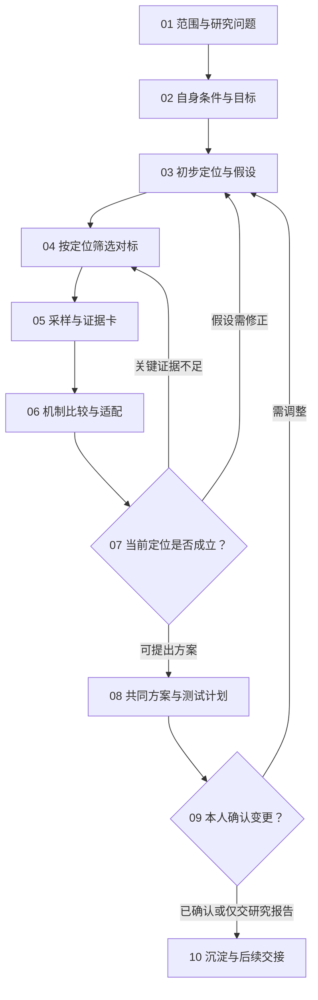

# SOP · 账号定位与对标分析

新建或调整账号方向，或解释既定定位和受众反馈之间的差距。定位决定对标怎么筛，对标证据反过来修正定位，必须作为一项往返任务做。单条作品找参考时直接用视频 SOP 的参考步骤，不重做账号定位。任务类型 research；共同约定见 [README](README.md) 第 4 节。

输入：本人目标和约束、[账号事实](../规范/账号信息.md)、[策略](../规范/定位与策略.md)、[偏好](../规范/偏好与经验.md)、[资产地图](../附录/README.md)，以及这次允许的研究范围。已有数据有日期，不能当实时快照。终点是共同方案、证据、差异、待验证假设和下一步测试；要改既定定位时取得本人确认后写回，不自动改账号资料。

技能：social-media-router（终点、范围、接续）、content-planning（研究问题、参考证据、表达机制）、performance-analysis（有授权后台数据时校准口径、验证假设）；入口见 `../SKILLS_INDEX.md`。目标和商业取舍以本人事实和确认为准，content-planning 提供研究方法，不冒充商业定位模型。

## 步骤

### P01 研究问题 · social-media-router
- 判断这次是从零定位、局部修正，还是针对一个问题研究；是研究还是获准变更。
- 把问题写具体，例如"作品吸引的人和付费需求是否匹配"，不要只写"研究优秀账号"。
- 明确平台、受众、可访问的资料和输出范围；只问会改变方向的缺项。
放行：问题能被证据或可检验的假设回答；目标不明就等待，不扩大成全平台长期运营。

### P02 自身条件与判断标准 · content-planning；有历史数据时配合 performance-analysis
- 列出目标优先级、能力和独有资产、可投入的时间、产出成本、收入路径和不愿做的事，每项注明来自本人陈述还是文件。
- 分清马上能交付、需要补能力和没有证据的能力；产品上线、粉丝或收入的旧快照不当作当前增长。
- 提出后续比较标准：吸引谁、提供什么价值、为什么持续关注、怎样低成本持续做、怎样验证业务目标。
放行：约束和事实明确；缺数字就写未知，不估算收入，不替本人承诺辞职时间。

### P03 初步定位与可证伪假设 · content-planning
- 描述受众的具体情境和需要，分清来看作品、想学方法、想用工具和找委托的人。
- 写出"为谁提供什么、为什么关注、和现有选择有什么不同"，再落到内容支柱、表达方式和业务承接。
- 每个重要判断附上证据、待验证部分和反证条件；已有明确方向就深化疑点，不强制重新发散多个身份。
产出：初步定位和假设清单，作为方案保存，不覆盖现行策略。放行：能据此定义对标筛选问题，不能只有一句口号。

### P04 按问题选对标 · content-planning（research-and-selection）
- 按角色分组：同受众或同价值的内容账号、同表达或生产方式的形式参考、商业路径相近的账号；每个写明为什么纳入。
- 成熟账号和资源、规模与本项目相近的账号都要看，不只拿大号的绝对互动数做判断。
- 用近期公开内容核验活跃度和相关性，记录查看日期和访问范围；不为凑数量加入无关账号。
产出：对标池（账号、平台、原始链接、研究角色、纳入理由、访问范围）。放行：每个样本都能回答定位问题；无法访问就换允许的来源或登记缺口。

### P05 采样与证据卡 · content-planning；比较可见指标时用 performance-analysis 的方法
- 按研究问题选近期作品，尽量覆盖同一账号的常见内容和不同的可见表现，不只挑最成功的一条。
- 卡片记录作者、原始链接、发布日期和查看时间、实际观察范围、公开指标原名和单位；看不到的播放、留存或收入不补造。
- 对实际看过的作品，记录选题、第一眼信息、观看动力、内容推进、视觉、节奏、标题封面、正文互动和可见的转化安排。
- 分清研究参考和计划使用的素材；链接不代表素材授权，没看完整视频不评价完整的运动和声音。
放行：观察可追溯，覆盖不足就注明限制；不进入本人的点赞和收藏列表做对标研究。

### P06 比较机制并判断适配 · content-planning；真实数据比较配合 performance-analysis
- 先在同账号、近似内容和时间条件下比较，再跨账号归纳；粉丝体量、投放、置顶和平台差异列为限制。
- 从"观众为什么点击、为什么留下、为什么互动或转化"提炼机制，指向实际画面、信息顺序或包装，而不是"高级、治愈、爆款"这类形容词。
- 把机制和 P02 的能力、时间、成本、品牌约束对照：能借鉴什么、要怎样改编、哪些条件不具备。
产出：机制比较表（观察证据／可能解释／适用条件／本项目改编／差异）。放行：事实和推断分开；不推断未公开的商单收入或后台因果，不照搬身份、镜头顺序和音乐。

### P07 用证据修正定位 · content-planning；有本账号数据时用 performance-analysis
- 对照 P03 的每个假设，标支持、削弱或仍未知，写明证据和竞争解释。
- 需求或差异判断不成立就回 P03 修改；只是关键证据不足就回 P04、P05 定向补充。
- 每一轮写清"补什么证据会改变决定"，达到信息需求就收敛，不无限扩大账号池。
放行：能形成有边界的共同方案；无法决定的关键业务选择交给本人。

### P08 共同方案和验证计划 · content-planning；测试设计用 performance-analysis
- 在同一份方案里写受众、价值、差异、内容支柱、表达、生产成本和业务路径，逐项链接对标证据。
- 写出第一轮内容和包装的假设与最小测试：改什么、保持什么、目标指标、观察窗口、什么结果支持或削弱判断。
- 明确本项目自己选择的差异，保留未知项和待本人决定的事项；建议不自动排进生成批次。
产出：`定位与对标方案.md` 或等价文件、证据卡、测试卡。放行：方案能指导取舍，有可执行的验证方式，不承诺增长或收入。

### P09 提交确认 · social-media-router；确认登记用任务工具
- 说明建议改变什么、为什么、证据和限制，提交可审阅的具体文件。
- 要改既定定位时添加 positioning 确认（放在沉淀之前），本人确认后绑定方案文件版本和原话。
- 本人只要研究报告时交报告并结束；没有确认不覆盖现行策略。反馈影响核心假设就回 P03，只是表述修改就只更新受影响的部分。
放行：变更授权明确；未回复就等待，不自动改昵称、简介或账号设置。

### P10 写回与交给下一次创作 · social-media-router；有发布数据后转[数据分析与反馈](数据分析与反馈.md)
- 获准的方向写回定位与策略；外部知识带来源和日期进 `../规范/外部知识.md`，偏好进 `../规范/偏好与经验.md`，研究过程和证据留任务目录。
- 给下一次创作交接已确认的定位、受众、内容支柱、要验证的假设和适用的对标机制；视频按对应 SOP 执行。
- 检查来源、推断、授权和文件引用，登记检查证据、任务和日志；只有当前请求明确包含后续内容时才继续。

完成条件：共同方案和证据可追溯，定位和对标相互校准过，变更已确认，下一步可以验证。缺必要证据时交已证实部分和缺口，如实标明任务是否仍在等待。
