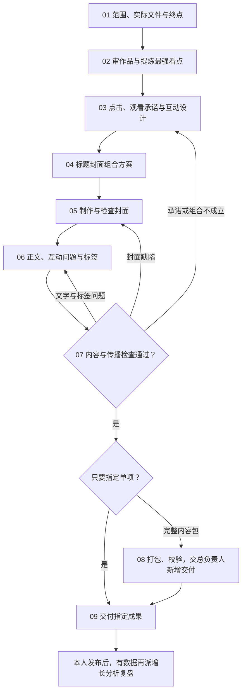

# 发布材料

后期给实际作品做封面、标题、正文、互动问题、标签和待发布文件夹时用。要设计点击理由和有意义的互动，并核对作品能不能兑现承诺；传播效果要等真实数据验证，不能把"自己觉得吸引人"当作点击会提高。独立补材料的任务类型是 delivery，同一视频任务里继续包装沿用 content；共同做法见 `agents/公共/规则.md`，封面、文案和交付包标准见 `agents/账号/内容与交付.md` 第 4 节。

只要文字或封面时停在那个成果。已有视频只包装时保留原字节和声音；发现缺陷可以提建议，编辑或重新生成必须在实际授权范围内。

技能入口见 `agents/SKILLS_INDEX.md`：publishing-delivery（copy-and-tags、packaging-and-checks）、content-production（cover-design）、video-frames、imagegen 或 codex-imagegen、social-media-router；打包用 `agents/role/后期/工具/发布包/`。

## 步骤

### D01 范围与有效源文件 · social-media-router、publishing-delivery
- 判断这次是完整包、只要标题文案、只要封面，还是修订已有材料；登记输入文件和请求终点。
- 核对有效成片版本、受众和平台、已有文字和封面、来源和检查限制。只包装时记录原视频哈希和音轨的使用范围。
- 独立补材料不重新发起视频选题或脚本确认；格式或身份有实质未知时回报总负责人。
放行：有足够的真实内容依据；找不到源文件不捏造封面或内容包。

### D02 审作品，提炼最强看点 · publishing-delivery、content-production；定位画面用 video-frames
- 能看就完整看成片，记录最值得停留的画面、关系、过程或信息和时间码，核实结尾实际给了什么回报。
- 分清已经呈现的、只在脚本里设想的和没验证的；找出目标观众为什么愿意看。没有自然看点就指出问题，不私自重做原片。
- 选出能支撑封面和标题的真实画面、道具和结果；没法观看时注明依据是片段、静帧还是本人摘要。
放行：传播承诺有实际作品支持，不拿希望发生的剧情写标题。

### D03 点击、观看与互动理由 · publishing-delivery
- 写清"谁会被什么具体关系、价值或问题吸引"，选作品最强的看点，不凭空制造冲突或收益。
- 明确点进来之后的回报和该保留的观看空间：信息片可以直接给结果，叙事片避免封面泄露全部回报。
- 选一种贴合内容的互动：命名、判断、选择、补规则、联系自身经历或提出真实需求；没有自然问题就不硬凑。
- 写下传播假设和适用观众，不给虚构的点击率或"肯定爆"。
放行：理由能指向实际内容；无关争议、虚假体验、没经本人同意的个人承诺不进定稿。

### D04 标题与封面组合 · publishing-delivery、content-production
- 封面负责识别和停留，标题补具体的观看理由，正文放额外信息，三处不重复同一句话。
- 需要比较时做少量机制不同的组合：画面焦点、封面短语、发布标题、保留的回报、预期互动；本人指定的标题原样保留。
- 每组在手机上扫读，看是否具体、有内容支撑、符合本片视觉语言；默认交一份定稿和简短理由。
放行：标题和封面互补，作品能兑现；要靠夸大才吸引人就回 D02 或 D03 重选看点。

### D05 制作封面并检查缩略图 · content-production（cover-design）、video-frames；生图用对应技能
- 从实际成片抽候选帧，按选定组合排版或适度海报化，不加正片没有的关键人物、效果、结果或承诺。
- 沿用账号的设计逻辑，保留本片的材质和美术；身份不变的部分和可变的风格分开核对。
- 生图或改图前读对应技能、看输入、传真实参考；出图后实际检查主体、文字和内容真实性，概念稿不算实际图片。
- 按 `agents/账号/账号配置.yaml` 的 cover 检查实际 PNG 的尺寸、比例、安全区、每个字和裁切，缩到手机缩略图大小看重点是否还清楚。
放行：没有错字、乱码、裁字或错误承诺；只改扩展名、只有大图清楚都不能放行。

### D06 正文、互动问题和标签 · publishing-delivery
- 用创作者口吻写真实情境、制作观察或有用信息，不替本人编造经历、意见、实验天数或收益。
- 正文补标题和封面没说的内容，保留需要观看的回报；互动用 D03 选定的具体问题，不套"点赞收藏关注"。
- 标签先求相关，按主题、形式、领域和分发规范选；要求实时热门时查真实来源，记录日期、平台、指标和单位，核实不了就只说相关。
- 保存 UTF-8 的 `发布文案.txt`，按标题、正文、标签三段写；删掉占位、备选和内部说明。
放行：口吻、事实和平台露出符合规范；没经本人同意的个人表态留在任务里等确认，不悄悄当定稿。

### D07 内容一致性与传播检查 · publishing-delivery、content-production

逐项检查并写证据，不用平均分掩盖关键失败：

| 检查项 | 怎么判断 | 不通过回到 |
|---|---|---|
| 点击理由 | 手机尺寸看封面和标题，能不能很快读出具体看点 | D03／D04 |
| 承诺兑现 | 对照正片时间码，标题封面有没有真实依据，有没有过度剧透或夸大 | D02／D03 |
| 三层互补 | 分别读封面、标题、正文，是否各自增加信息 | D04／D06 |
| 互动质量 | 问题和本片有关、容易具体回答，没有强迫或虚构反应 | D03／D06 |
| 搜索与标签 | 关键词真实相关；说热门要有时间和指标依据；符合数量和露出规则 | D06 |
| 封面质量 | 格式、尺寸、文字、主体、裁切和缩略图 | D05 |
| 源片保留 | 只包装时音视频没被编辑，源片和拟交付视频哈希一致 | D01／D08 |
| 账号与授权 | 没碰实际发布和互动页面，材料符合 `agents/账号/内容与交付.md` 第 5 节 | 按规范修正 |

传播判断写"待发布数据验证"，不能写成已经提高了点击或互动。

### D08 打包、校验，交总负责人新增交付 · 发布包、任务管理
- 在当前任务准备有效成片、PNG 封面和 UTF-8 文案，用 `agents/role/后期/工具/发布包/` 打包到交付暂存目录；它检查 TXT 三段、封面比例、视频完整解码和字节一致，审美、试听和实时标签仍靠 D07 和审片。
- 用任务管理工具的 `check-package` 核对暂存包和拟用的新名称；整理时间用实际北京时间，不冒充发布时间。
- 把包的位置和拟用名称交给总负责人：它确认目标不存在后，一条命令整份复制到 `交付/` 的全新目录，核对文件清单和哈希，再用 `delivery` 登记；同名就换合规的新名称，不追加到旧包。
放行：三件成品完整、本人能打开；工程、提示词、凭据、回包和报告不进发布包。

### D09 交付、验收与数据交接 · social-media-router、publishing-delivery
- 只要文字或封面时交对应成果和依据，不称三文件包齐全；窄交付不能用 other 绕过完整包规范。
- 给本人能打开的实际文件或目录和简短说明，指出需要决定的事项；本地有文件不等于已上传到外部平台。
- 本人的验收由总负责人登记；修订新增完整版本，不继承旧版验收。发布和 AI 内容声明由本人完成。
- 有验证计划时，交接封面、标题、正文的版本，点击和互动假设，要看的指标和观察窗口；拿到真实发布证据后由总负责人派增长分析复盘。

完成条件：请求范围内的材料齐全可用，点击和互动理由经过具体检查，内容承诺真实，格式和版本核对完成，验收状态明确；实际表现仍需真实数据证明。
